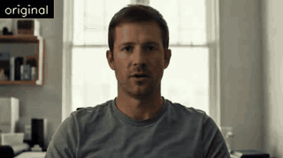
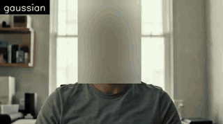
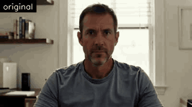
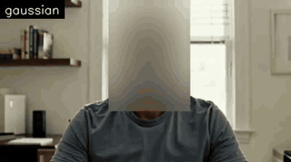
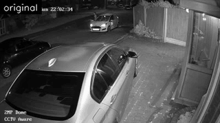
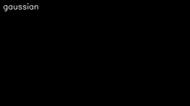
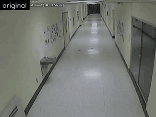
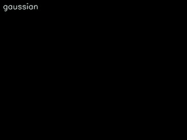

<p align="center">
  
</p>

# petrify

[](https://github.com/starside-io/petrify)
[](https://github.com/starside-io/petrify)
[](LICENSE)
[](https://www.python.org)
[](https://opencv.org)
[](https://ffmpeg.org)

**Freeze the world. Keep the clock ticking.**

Built by [starside.io](https://starside.io). We build tools at the intersection of computer vision and human experience.

---

### Why *petrify*?

Security footage is relentlessly honest. It records everything: every arrival, every departure, every face crossing a threshold it shouldn't. But that honesty is exactly what makes it sensitive.

**petrify** takes a different approach. The moment a person enters the scene, the world freezes into a perfect, clean still of the empty space. Only the burned-in clock keeps running, composited live onto every frozen frame. The scene says *nothing happened here*. The timestamp says *time kept moving.*

`petrify` comes from the idea of turning a scene to stone: immovable, unchanging, as if the world held its breath. The motion is real. The stillness is manufactured. Only the time is true.

It uses [OpenCV's MOG2](https://docs.opencv.org/4.x/d7/d7b/classcv_1_1BackgroundSubtractorMOG2.html) background subtractor, a [HOG person detector](https://docs.opencv.org/4.x/d5/d33/structcv_1_1HOGDescriptor.html), and a static background differ. Three complementary signals, each aimed at a different kind of subject: one moving fast, one standing still, one barely visible at the edge of the frame.

---

When a security camera records someone entering a building, does the output need to show *who* was there? **petrify** answers that question with a short pre-scan and a single processing pass. The pre-scan picks the clean background. The processing pass composites every frame so only the timestamp survives.

---

## Demo

**Left: original footage &nbsp;·&nbsp; Right: petrify output**


*Driveway camera · person enters from street · petrify shows only the empty driveway with the live clock*


*School corridor · person walks and lingers · petrify holds the clean background while the timestamp keeps running*

---

## What it does

petrify removes people from fixed-camera footage while keeping the scene and its burned-in clock. The built-in `erase` mode freezes the subject out: whenever someone is in view, the output shows a clean still of the empty scene, and the live timestamp region is pasted on top of every frame. Installed plugins can add other modes, such as the `shadow` plugin in this repository, which keeps the live frame and covers faces or bodies instead.

There are two ways to run it:

- `petrify input.mp4 output.mp4` processes a video file.
- `petrify run --source SPEC` reads from a file, a webcam, a network stream, or an image folder, and writes to a file, a live web page, a preview window, or a virtual camera for video calls.

| Scenario | What petrify removes | What survives |
|---|---|---|
| **Privacy compliance (PDPA / GDPR)** | Identifiable individuals in public spaces | Scene context · verified timeline |
| **Footage compression** | Sparse motion (bird, leaf, flag) | Static background · motion-free stream |
| **Space & layout analysis** | People occluding floor plans | Clean geometry for heatmaps / CAD |
| **Physical hazard detection** | Human presence masking static hazards | Exposed obstacles, spills, trip points |
| **AI training data** | Subject identity from annotated scenes | Background environment · ground truth |
| **Any fixed camera** | All foreground subjects | Clean background · live timestamp |

> **Disclaimer:** petrify is provided for educational and research purposes. Always ensure you have the legal right to process any footage you use, including compliance with applicable privacy laws (PDPA, GDPR, CCPA, and equivalents). Do not use petrify to process footage of individuals without proper authorisation, consent, or a lawful basis.

Read [Before you rely on it](docs/limitations.md) for the known limitations, in particular for live use.

---

## Get started

Install FFmpeg, which petrify calls as a subprocess:

- macOS: `brew install ffmpeg`
- Ubuntu / Debian: `sudo apt install ffmpeg`
- Windows: download from https://ffmpeg.org/download.html and add to PATH

Install petrify with [pipx](https://pipx.pypa.io):

```bash
pipx install petrify
```

Optional extras, only needed by `petrify run`:

- `petrify[web]` for `--web`, the local web page
- `petrify[virtualcam]` for `--virtualcam`; on macOS it also needs OBS 30 or newer
- an OpenCV build with GUI support for `--preview`
- the `petrify-shadow` plugin and its model files for `--mode shadow`

With pipx: `pipx install 'petrify[web,virtualcam]'`. See [Installation](docs/installation.md) for source installs, the extras, system requirements, and Docker.

```bash
# A video file. Auto-detects the background and the timestamp ROI
petrify input.mp4 output.mp4

# Webcam with the live web page to watch the feed and change settings
petrify run --source camera:0 --web

# Webcam to a virtual camera for video calls, with a preview window
petrify run --source camera:0 --virtualcam --preview

# Shadow mode: keep the live frame and cover the people in it
petrify run --source input.mp4 --output out.mp4 --mode shadow \
    --mode-option styles=bodybox,facebox \
    --detector both --person-detector dnn --faces --track
```

---

## Webcam test

<table>
  <tr>
    <th>Original</th>
    <th>Shadow mode</th>
  </tr>
  <tr>
    <td></td>
    <td></td>
  </tr>
  <tr>
    <td></td>
    <td></td>
  </tr>
</table>

Both clips are AI-generated (Runway Gen-4.5) webcam-style test footage; no real person appears in them. The right column cycles through every shadow style (gaussian, pixelate, noise, facebox, eyebar, silhouette, silhouette_color, outline + facebox, bodybox), run with `--mode shadow --faces --segment --detector both --person-detector dnn --track --mode-option orphan=head`.

On webcam framing, the silhouette styles with `orphan=head` currently black most of the frame (a known issue being tracked), and `bodybox` covers the whole body box by design.

## Security camera test

<table>
  <tr>
    <th>Original</th>
    <th>Shadow mode</th>
  </tr>
  <tr>
    <td></td>
    <td></td>
  </tr>
  <tr>
    <td></td>
    <td></td>
  </tr>
</table>

The same two clips as the erase demo above, with the same shadow command and style cycle as the webcam test.

---

## Documentation

- [Installation](docs/installation.md): FFmpeg, pipx, optional extras, system requirements, Docker.
- [Usage](docs/usage.md): file mode quick start, example output, auto-detection, full CLI reference, encoding, performance.
- [`petrify run`](docs/run.md): sources, outputs, run options, the cctv profile, background strategies, fail closed, modes and plugins, model-based detectors and their model files.
- [The web page](docs/web.md): token and password login, what can be changed during a run, security model.
- [Virtual camera](docs/virtual-camera.md): use petrify as your camera in a video call (OBS on macOS, Windows, Linux).
- [Running several cameras](docs/deployment.md): one process per camera, systemd unit, stops and stalled cameras, capacity.
- [How it works](docs/how-it-works.md): the three-detector pipeline and why it uses three detectors.
- [Before you rely on it](docs/limitations.md): known limitations.
- [Writing a mode plugin](docs/PLUGINS.md): the plugin interface.
- [Shadow plugin](plugins/petrify-shadow/README.md): the `shadow` mode, its styles, and its limits.

---

## Contributing

Contributions are welcome. See [CONTRIBUTING.md](CONTRIBUTING.md) for how to set up a development environment, run the test suite, and open a pull request.

---

## License

Apache 2.0. See [LICENSE](LICENSE).

---

Made with ❤️ by [starside.io](https://starside.io) · [github.com/starside-io/petrify](https://github.com/starside-io/petrify)
