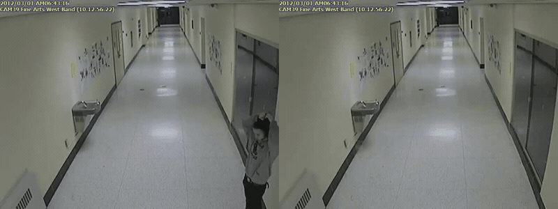

<p align="center">
  
</p>

# petrify

[](https://github.com/starside-io/petrify)
[](https://github.com/starside-io/petrify)
[](LICENSE)
[](https://www.python.org)
[](https://opencv.org)
[](https://ffmpeg.org)

**Freeze the world. Keep the clock ticking.**

Built by [starside.io](https://starside.io). We build tools at the intersection of computer vision and human experience.

---

### Why *petrify*?

Security footage is relentlessly honest. It records everything: every arrival, every departure, every face crossing a threshold it shouldn't. But that honesty is exactly what makes it sensitive.

**petrify** takes a different approach. The moment a person enters the scene, the world freezes into a perfect, clean still of the empty space. Only the burned-in clock keeps running, composited live onto every frozen frame. The scene says *nothing happened here*. The timestamp says *time kept moving.*

`petrify` comes from the idea of turning a scene to stone: immovable, unchanging, as if the world held its breath. The motion is real. The stillness is manufactured. Only the time is true.

It uses [OpenCV's MOG2](https://docs.opencv.org/4.x/d7/d7b/classcv_1_1BackgroundSubtractorMOG2.html) background subtractor, a [HOG person detector](https://docs.opencv.org/4.x/d5/d33/structcv_1_1HOGDescriptor.html), and a static background differ. Three complementary signals that together catch every subject: one moving fast, one standing still, one barely visible at the edge of the frame.

---

When a security camera records someone entering a building, does the output need to show *who* was there? **petrify** answers that question with a two-pass pipeline. The first pass builds the clean background. The second composites every frame so only the timestamp survives.

---

## Demo

**Left: original footage &nbsp;·&nbsp; Right: petrify output**


*Driveway camera · person enters from street · petrify shows only the empty driveway with the live clock*


*School corridor · person walks and lingers · petrify holds the clean background while the timestamp keeps running*

---

## Use cases

| Scenario | What petrify removes | What survives |
|---|---|---|
| **Privacy compliance (PDPA / GDPR)** | Identifiable individuals in public spaces | Scene context · verified timeline |
| **Footage compression** | Sparse motion (bird, leaf, flag) | Static background · motion-free stream |
| **Space & layout analysis** | People occluding floor plans | Clean geometry for heatmaps / CAD |
| **Physical hazard detection** | Human presence masking static hazards | Exposed obstacles, spills, trip points |
| **AI training data** | Subject identity from annotated scenes | Background environment · ground truth |
| **Any fixed camera** | All foreground subjects | Clean background · live timestamp |

---

> **Disclaimer:** petrify is provided for educational and research purposes. Always ensure you have the legal right to process any footage you use, including compliance with applicable privacy laws (PDPA, GDPR, CCPA, and equivalents). Do not use petrify to process footage of individuals without proper authorisation, consent, or a lawful basis.

---

## Installation

### 1. System FFmpeg (required)

petrify calls `ffmpeg` via subprocess. Install it first:

```bash
# macOS
brew install ffmpeg

# Ubuntu / Debian
sudo apt install ffmpeg

# Windows: download from https://ffmpeg.org/download.html and add to PATH
```

### 2. petrify

The recommended install method is [pipx](https://pipx.pypa.io). It puts `petrify` on your PATH without touching your system Python:

```bash
# Install pipx if you don't have it
brew install pipx        # macOS
# pip install --user pipx  # Linux / Windows

# Install petrify
pipx install petrify
```

Or install from source:

```bash
git clone https://github.com/starside-io/petrify.git
cd petrify
pipx install -e .
```

Or with plain pip into a virtualenv:

```bash
pip install petrify
```

---

## Quick start

```bash
# Zero config. Auto-detects background + timestamp ROI
petrify input.mp4 output.mp4

# Explicit ROI (skip auto-detection for speed)
petrify input.mp4 output.mp4 --roi 0 55 700 60

# More sensitive. Catches slower or more distant subjects
petrify input.mp4 output.mp4 --threshold 200 --bg-diff-area-threshold 100

# Disable timestamp overlay entirely
petrify input.mp4 output.mp4 --no-roi

# Higher quality encode
petrify input.mp4 output.mp4 --crf 18 --preset slow

# Apple Silicon GPU encode
petrify input.mp4 output.mp4 --hwaccel videotoolbox --codec h264_videotoolbox

# NVIDIA GPU encode (requires ffmpeg with NVENC)
petrify input.mp4 output.mp4 --hwaccel cuda --codec h264_nvenc

# Debug. Print every detection decision
petrify input.mp4 output.mp4 --verbose
```

### Example output

```
██████╗ ███████╗████████╗██████╗ ██╗███████╗██╗   ██╗
██╔══██╗██╔════╝╚══██╔══╝██╔══██╗██║██╔════╝╚██╗ ██╔╝
██████╔╝█████╗     ██║   ██████╔╝██║█████╗   ╚████╔╝
██╔═══╝ ██╔══╝     ██║   ██╔══██╗██║██╔══╝    ╚██╔╝
██║     ███████╗   ██║   ██║  ██║██║██║        ██║
╚═╝     ╚══════╝   ╚═╝   ╚═╝  ╚═╝╚═╝╚═╝        ╚═╝

  Made with ❤️  by starside.io

Input  : front_door.mp4  (1920×1080 @ 25 fps · 1169 frames)
Output : output.mp4

Auto ROI scan ── 60 frame pairs ──────────────────────────────────
  Detected ROI  x=0 y=0 w=642 h=129
  → To skip next time: --roi 0 0 642 129

Background scan ── searching for clean frame ──────────────────────
  Auto background: frame 1165  (46.6 s into video)

Pass 1 ── classifying 1169 frames ─────────────────────────────────
  MOG2 · HOG · BackgroundDiffer
  subject detected in 1015 / 1169 frames (86.8%)
  gap-fill +15 frames · cold-start freeze 0–49

Pass 2 ── compositing ─────────────────────────────────────────────
  frozen=1151 (98.5%)  pass-through=18 (1.5%)

Re-encoding → output.mp4  (libx264 crf=23 medium)
Done.
```

---

## How it works: three-detector pipeline

petrify uses three complementary signals that together cover every failure mode:

```
input video
    │
    ├── Pass 0: Auto ROI detection (frame-diff + Laplacian edges)
    │          Finds the burned-in timestamp region automatically.
    │
    ├── Pass 0: Auto background selection (HOG scan → latest clean frame)
    │          Locks the reference background before any processing.
    │
    ├── Pass 1: Frame classification
    │    │
    │    ├── MOG2 (motion)        catches moving subjects
    │    ├── HOG  (person)        catches stopped subjects MOG2 adapted away
    │    └── BackgroundDiffer     catches tiny / partial / edge subjects
    │              ↓                both detectors miss
    │         has_subject[N] = True / False
    │              ↓
    │         gap-fill ±15 frames  (bridges missed detections mid-sequence)
    │         cold-start freeze    (MOG2 warmup window)
    │
    └── Pass 2: Compositing
         │
         ├── Track A: frozen background (locked clean frame)
         │            used when has_subject[N] = True
         │
         ├── Track B: live ROI extract from real frame (always)
         │            timestamp keeps ticking regardless of freeze state
         │
         └── Compositor → paste ROI → VideoWriter → FFmpeg re-encode + audio mux
                                                            ↓
                                                       output.mp4
```

### Why three detectors?

| Detector | Catches | Misses |
|---|---|---|
| **MOG2** (adaptive BG) | Fast-moving subjects | Subject who stands still → model adapts them in |
| **HOG** (person shape) | Stopped subjects with visible full body | Partial bodies, small silhouettes, unusual poses |
| **BackgroundDiffer** (static diff) | *Everything* different from the empty-corridor reference: moving or still, full or partial, near or far | Nothing, as long as the background frame is clean |

The static background differ is the safety net. Because its reference never adapts, a person standing perfectly still for 60 seconds is still detected on every single frame. They are simply always different from the known-empty scene.

---

## Auto-detection

### Timestamp ROI

When `--roi` is not specified, petrify automatically finds the timestamp rectangle using a two-pass approach:

1. **Frequency pass.** Sample 60 frame pairs spaced 1 second apart. Find pixels that change in at least 60% of pairs (the seconds digits).
2. **Edge pass.** Run Laplacian edge detection in the detected Y strip. Walk column-by-column from the nearest frame corner and stop at the first gap greater than 30 px. Captures the full text width including static hours and camera labels.

The detected ROI is printed at startup so you can hard-code it on future runs to skip the ~10-second scan:

```
→ To skip auto-detection next time: --roi 0 0 642 129
```

### Background frame

petrify scans every 5th frame with the HOG person detector, collects all clean frames (no person detected), and locks the **latest** one as the reference background. For typical security footage the subject leaves at the end of the clip, so the cleanest frame is usually in the final few seconds. Use `--background-frame N` to override.

---

## CLI reference

```
usage: petrify [options] INPUT OUTPUT
```

### Positional

| Argument | Description |
|---|---|
| `INPUT` | Path to the input video |
| `OUTPUT` | Path for the output video |

### ROI / Compositor

| Flag | Default | Description |
|---|---|---|
| `--roi X Y W H` | auto | Bounding box of the live timestamp region (px, top-left origin). Auto-detected if omitted. |
| `--no-roi` | off | Disable timestamp overlay and skip auto-detection entirely. |
| `--roi-scan-samples N` | 60 | Frame pairs to diff during auto ROI detection. |
| `--roi-scan-min-freq F` | 0.6 | Min change-frequency for a pixel to be part of the anchor. |
| `--roi-scan-edge-threshold F` | 80 | Laplacian column energy threshold for Pass 2 (text vs. background). |
| `--roi-scan-edge-gap-tolerance PX` | 30 | Max inter-character gap before the edge scan stops. |

### Background / Reference

| Flag | Default | Description |
|---|---|---|
| `--background-frame N` | auto | Frame index to use as the locked reference. Auto-scanned if omitted. |
| `--no-bg-diff` | off | Disable the static background differ (reduces recall). |
| `--bg-diff-pixel-threshold INT` | 25 | Per-pixel ΔE above which a pixel is counted as changed. |
| `--bg-diff-area-threshold PX` | 200 | Changed-pixel area (px² in downsampled space) to fire the differ. |

### Detector mode

| Flag | Default | Description |
|---|---|---|
| `--detector {motion,person,both}` | both | Active detectors for Pass 1. |
| `--hog-min-confidence F` | 0.3 | HOG detection confidence floor. Raise to 1.2 if false positives on architectural structures. |
| `--hog-min-box-area PX` | 1500 | Minimum HOG detection bounding-box area. |

### Motion (MOG2)

| Flag | Default | Description |
|---|---|---|
| `--threshold PX` | 500 | Foreground contour area (downsampled px²) to classify a frame as motion. Lower = more sensitive. |
| `--history N` | 200 | MOG2 background model window (frames). |
| `--gap-fill N` | 15 | Expand every detected region ±N frames to bridge gaps. |
| `--downsample F` | 0.5 | Resize factor before detection. 0.5 = 4× speedup. |

### Encoding

| Flag | Default | Description |
|---|---|---|
| `--codec CODEC` | `libx264` | FFmpeg video codec. |
| `--crf INT` | 23 | Constant Rate Factor (lower = better quality). |
| `--preset PRESET` | `medium` | Encoding speed/quality tradeoff. |
| `--hwaccel ACCEL` | none | FFmpeg `-hwaccel` for hardware-accelerated decoding. |
| `--verbose` | off | Enable DEBUG-level log output. |

---

## Performance

| Resolution | CPU (libx264 medium) | Apple M-series | NVIDIA NVENC |
|---|---|---|---|
| 480p | Real-time | Real-time | Real-time |
| 720p | Real-time | Real-time | Real-time |
| 1080p | 0.5–1× real-time | Real-time | Real-time |
| 4K | Needs GPU | Recommended | Recommended |

- Use `--downsample 0.25` for 4K to reduce MOG2 cost.
- The bottleneck for large resolutions is OpenCV's `VideoWriter` (uncompressed frame I/O). Use a fast SSD or a RAM-backed `/tmp`.

---

## Docker

```dockerfile
FROM python:3.12-slim
RUN apt-get update && apt-get install -y ffmpeg && rm -rf /var/lib/apt/lists/*
RUN pip install petrify
ENTRYPOINT ["petrify"]
```

```bash
docker run --rm \
  -v "$(pwd)/data:/data" \
  petrify \
  /data/input.mp4 /data/output.mp4
```

---

## Contributing

Contributions are welcome. See [CONTRIBUTING.md](CONTRIBUTING.md) for how to set up a development environment, run the test suite, and open a pull request.

---

## License

Apache 2.0. See [LICENSE](LICENSE).

---

Made with ❤️ by [starside.io](https://starside.io) · [github.com/starside-io/petrify](https://github.com/starside-io/petrify)
